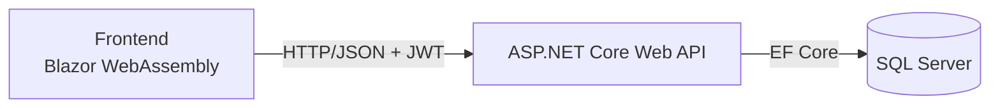

# Sistema de Gestión de Préstamos de Equipos y Recursos

Proyecto Final 03 · Aplicaciones y Servicios Web · ITM

Aplicación web para gestionar el préstamo temporal de equipos y recursos de una institución educativa: consulta de disponibilidad, solicitud, evaluación, entrega, seguimiento, prórroga y devolución.

| Componente | Estado |
|---|---|
| Backend: API REST + base de datos | ✅ Completo: cubre CA-01 a CA-06 |
| Frontend (Blazor WebAssembly + MudBlazor) | ✅ Completo: pantallas por rol conectadas a la API |

---

## 1. Información general

| Campo | Valor |
|---|---|
| Asignatura | Aplicaciones y Servicios Web |
| Programa | Tecnología en Desarrollo de Software — ITM |
| Fecha | Noviembre de 2026 |
| Repositorio | https://github.com/Samuel-Sanchez24/Prestamos-Equipos |

| Integrante | Contribución |
|---|---|
| Samuel Andrés Sánchez Orrego | Requisitos, diseño, backend completo (dominio, persistencia, API REST, seguridad, reglas de negocio), pruebas funcionales y documentación. |
| Dani Moreno Ciro | Levantamiento de requisitos (entrevista); frontend en Blazor WebAssembly con MudBlazor: cliente HTTP, sesión, pantallas por rol e integración con la API. |

---

## 2. Descripción del sistema

**Problema.** Las solicitudes y entregas se registraban en formularios y hojas de cálculo independientes. No había forma de saber qué recursos estaban disponibles ni quién debía devolverlos, y se presentaban asignaciones simultáneas sobre un mismo recurso.

**Solución.** Una API REST que controla el ciclo completo del préstamo y evita asignaciones incompatibles, con persistencia en SQL Server.

| Actor | Qué puede hacer |
|---|---|
| **Solicitante** (estudiante o docente) | Registrarse, consultar disponibilidad, reservar uno o varios recursos, cancelar, pedir prórroga y consultar su historial. |
| **Técnico** (responsable de préstamos) | Aprobar o rechazar, entregar, marcar no recogida, registrar devoluciones (con o sin daño), gestionar prórrogas y el estado de los recursos. |
| **Coordinación** | Consultar información consolidada, préstamos, responsables e historial. Solo consulta. |
| **Administrador** | Registrar personal y administrar categorías y recursos. |

**Restricciones del alcance.** No incluye QR/RFID, notificaciones, sanciones económicas, compras ni mantenimiento físico.

Requisitos completos en [`docs/requisitos.md`](docs/requisitos.md).

---

## 3. Requisitos y alcance

- **Método:** entrevista semiestructurada con el docente en el rol de representante de la institución. El registro está en [`docs/entrevista.md`](docs/entrevista.md).
- **Decisiones confirmadas por el docente:** reservas con anticipación, varios recursos por solicitud, un semestre de préstamo máximo para estudiantes y dos para docentes, cancelación antes de recibir el recurso, prioridad al primero que pide, prórrogas y retiro de los recursos dañados.
- **Decisiones del equipo:** los aspectos no definidos en la entrevista están en la sección 13 de `requisitos.md`, por ejemplo 180 días por semestre o que el técnico aprueba las prórrogas.
- **Especificación:** 19 requisitos funcionales, 10 no funcionales, 18 reglas de negocio y 12 historias de usuario con criterios de aceptación, priorizados con MoSCoW.

---

## 4. Arquitectura, diseño de API y modelo de datos



**Arquitectura Limpia.** Las dependencias apuntan hacia el dominio:

| Carpeta de solución | Proyecto | Responsabilidad |
|---|---|---|
| Core | `Prestamos.Domain` | Entidades, estados y reglas de transición (`Aprobar()`, `Entregar()`, `RegistrarDevolucion()`…) |
| Core | `Prestamos.Application` | Casos de uso, validaciones (FluentValidation) e interfaces |
| Core | `Prestamos.Contracts` | DTOs compartidos entre la API y el frontend |
| Infrastructure | `Prestamos.Persistence` | EF Core, configuraciones de tablas, migraciones, repositorios y datos semilla |
| Presenters | `Prestamos.Api` | Controladores, JWT, manejo de errores, CORS y Swagger |
| Presenters | `Prestamos.Web` | Interfaz Blazor WebAssembly |

**Modelo de datos.** 7 tablas: `Usuarios`, `Categorias`, `Recursos`, `Solicitudes`, `DetallesSolicitud`, `Prorrogas` y `Movimientos`. Tienen claves únicas, claves foráneas con `RESTRICT` y restricciones `CHECK` de fechas.

**Decisiones clave.**
- La disponibilidad se **calcula** por cruce de fechas; no se guarda en un campo.
- Las transiciones de estado se exponen como acciones `POST`.
- Las reservas simultáneas se controlan con **bloqueo de filas** (`UPDLOCK, HOLDLOCK`) dentro de una transacción.
- Cada cambio de estado se registra en `Movimientos`.


**Pantallas del frontend** (`src/Prestamos.Web`). El menú lateral muestra solo las del rol del usuario:

| Ruta | Pantalla | Rol | CA |
|---|---|---|---|
| `/login`, `/registro` | Inicio de sesión y registro | Público | — |
| `/catalogo` | Catálogo con disponibilidad por fechas: tarjetas para el solicitante (selección y envío de la solicitud) y tabla para el personal. El detalle del equipo se abre en un panel lateral, donde el técnico reporta daño o reparación y el administrador da de baja. | Todos | CA-01, CA-02 |
| `/solicitudes` | Mis solicitudes (solicitante) o todas (personal), con filtros | Todos | CA-02, CA-05 |
| `/solicitudes/{id}` | Detalle: cancelar, pedir prórroga, aprobar o rechazar, entregar, no recogida, devolución por recurso, prórrogas e historial | Todos (acciones según rol) | CA-02 a CA-05 |
| `/tecnico/bandeja` | Pendientes, por entregar y en préstamo. Aprobar, rechazar, entregar y registrar devoluciones en un panel lateral, sin salir de la tabla | Técnico | CA-03, CA-04, CA-05 |
| `/tecnico/prorrogas` | Aprobar o rechazar prórrogas | Técnico | CA-05 |
| `/coordinacion` | Indicadores, préstamos con responsables y filtros | Coordinación, Técnico | CA-06 |
| `/admin/usuarios`, `/admin/recursos` | Personal, categorías y recursos, con formularios en panel lateral | Administrador | — |

**Sistema de diseño.** Índigo `#4F46E5` como color primario, fondo `#F8FAFC`, tipografía Inter (JetBrains Mono para códigos y fechas), sidebar oscuro, estados en píldoras con contraste AA y paneles laterales deslizables (`wwwroot/css/app.css`, `Theme/PrestamosTheme.cs`).

Diseño completo, con diagrama ER, diagramas de estado, especificación de la API y prototipos: [`docs/diseno.md`](docs/diseno.md).

---

## 5. Configuración del entorno

### 5.1 Requisitos de software
| Software | Versión |
|---|---|
| .NET SDK | 10.0 |
| SQL Server | LocalDB (incluido con Visual Studio) o SQL Server Express |
| IDE | Visual Studio 2026 (recomendado) o VS Code con C# Dev Kit |
| Git | Cualquier versión reciente |

### 5.2 Pasos

**1. Clonar el repositorio**
```bash
git clone https://github.com/Samuel-Sanchez24/Prestamos-Equipos.git
cd Prestamos-Equipos
```

**2. Configurar la clave JWT.** No se incluye en el repositorio. Debe tener al menos 32 caracteres.
- En Visual Studio: clic derecho en `Prestamos.Api` → **Administrar secretos de usuario**, y escribe:
  ```json
  { "Jwt:Clave": "clave-de-desarrollo-prestamos-itm-2026-cambiar" }
  ```
- O desde la terminal:
  ```bash
  dotnet user-secrets set "Jwt:Clave" "clave-de-desarrollo-prestamos-itm-2026-AySW" --project src/Prestamos.Api
  ```

**3. Revisar la cadena de conexión.** Está en `src/Prestamos.Api/appsettings.json` y por defecto usa LocalDB, sin contraseña. Para SQL Server Express, cámbiala o sobrescríbela con secretos de usuario: `ConnectionStrings:Default`. En [`.env.example`](.env.example) están todas las variables configurables.

**4. Crear la base de datos con los datos semilla**
- En Visual Studio: **Herramientas → Administrador de paquetes NuGet → Consola**:
  ```powershell
  Update-Database -Project Prestamos.Persistence -StartupProject Prestamos.Api
  ```
- O desde la terminal, con la herramienta `dotnet-ef` instalada:
  ```bash
  dotnet ef database update --project src/Prestamos.Persistence --startup-project src/Prestamos.Api
  ```

**5. Ejecutar la API y el frontend**
- En Visual Studio: clic derecho en la solución → **Configurar proyectos de inicio** → **Varios** → `Prestamos.Api` y `Prestamos.Web` en **Iniciar**, perfil **https** → **Ctrl+F5** (*Iniciar sin depurar*). Con F5 el depurador se detiene en las excepciones de negocio (400/404/409) que la API ya convierte en ProblemDetails.
- O desde dos terminales:
  ```bash
  dotnet run --project src/Prestamos.Api --launch-profile https
  dotnet run --project src/Prestamos.Web --launch-profile https
  ```

**6. Abrir la aplicación**
| Qué | URL |
|---|---|
| Aplicación web | https://localhost:7262 |
| Documentación de la API (Swagger) | https://localhost:7011/swagger |

El frontend toma la URL de la API de `src/Prestamos.Web/wwwroot/appsettings.json` (`ApiUrl`), y la API acepta su origen por CORS (`Cors:OrigenesPermitidos`).

### 5.3 Usuarios de prueba (ficticios)
Todos usan la contraseña **`Prestamos2026*`**.

| Correo | Rol |
|---|---|
| `admin@prestamos.test` | Administrador |
| `tecnico@prestamos.test` | Técnico |
| `coordinacion@prestamos.test` | Coordinación |
| `ana.perez@prestamos.test` | Solicitante (estudiante) |
| `juan.martinez@prestamos.test` | Solicitante (docente) |

Los datos semilla incluyen 4 categorías, 12 recursos (uno dañado) y 8 solicitudes, una en cada estado, con su historial. Para volver al estado inicial:
```powershell
Drop-Database -Project Prestamos.Persistence -StartupProject Prestamos.Api
Update-Database -Project Prestamos.Persistence -StartupProject Prestamos.Api
```

### 5.4 Problemas frecuentes
| Síntoma | Causa y solución |
|---|---|
| La API no arranca: *"Falta 'Jwt:Clave'"* | No se configuró el secreto del paso 2, o la clave tiene menos de 32 caracteres. |
| `Add-Migration` o `Update-Database`: *"Una directiva de Control de aplicaciones bloqueó este archivo"* | Windows 11 bloquea las DLL sin firmar. Desactiva **Control Inteligente de Aplicaciones** en Seguridad de Windows → Control de aplicaciones y navegador. |
| Swagger muestra *"Failed to load API definition"* | La API no está en modo `Development`. Revisa `ASPNETCORE_ENVIRONMENT` en `launchSettings.json`. |

---

## 6. Servicios web implementados

Prefijo `/api`, formato JSON y autenticación con `Authorization: Bearer <token>`, salvo en registro, login y estado. Los errores siguen el formato **ProblemDetails** (RFC 9457).

| Método | Ruta | Rol | Descripción | Requisito |
|---|---|---|---|---|
| GET | `/api/estado` | Público | Estado de la API y de la conexión a la base de datos | RNF-07 |
| POST | `/api/auth/registro` | Público | Registro de solicitante | RF-01 |
| POST | `/api/auth/login` | Público | Inicio de sesión; devuelve el JWT | RF-02 |
| GET | `/api/auth/yo` | Autenticado | Datos del usuario actual | RF-02 |
| POST | `/api/usuarios` | Administrador | Registrar técnico o coordinador | RF-03 |
| GET | `/api/usuarios` | Administrador | Listar usuarios (filtro `rol`) | RF-03 |
| GET | `/api/usuarios/{id}` | Administrador | Detalle de un usuario | RF-03 |
| PATCH | `/api/usuarios/{id}` | Administrador | Corregir el tipo de solicitante o activar/desactivar | RF-03 |
| GET | `/api/categorias` | Autenticado | Listar categorías | RF-05 |
| POST | `/api/categorias` | Administrador | Crear categoría | RF-04 |
| GET | `/api/recursos` | Autenticado | Catálogo con disponibilidad (`desde`, `hasta`, `categoriaId`, `soloDisponibles`) | RF-05 |
| GET | `/api/recursos/{id}` | Autenticado | Detalle con próximas reservas | RF-05 |
| POST | `/api/recursos` | Administrador | Registrar recurso | RF-04 |
| PUT | `/api/recursos/{id}` | Administrador | Editar recurso | RF-04 |
| PATCH | `/api/recursos/{id}/estado` | Técnico / Administrador | Dañado ↔ Disponible (técnico) · Dar de baja (administrador) | RF-06 |
| GET | `/api/recursos/{id}/movimientos` | Técnico / Coordinación / Administrador | Historial del recurso | RF-19 |
| POST | `/api/solicitudes` | Solicitante | Registrar solicitud | RF-07 |
| GET | `/api/solicitudes` | Autenticado | Listar (el solicitante solo ve las suyas; filtros `estado`, `vencidas`, `desde`, `hasta`) | RF-08, RF-10, RF-17 |
| GET | `/api/solicitudes/{id}` | Dueño / personal | Detalle con recursos, devoluciones y prórrogas | RF-08 |
| POST | `/api/solicitudes/{id}/cancelar` | Solicitante (dueño) | Cancelar (pendiente o aprobada) | RF-09 |
| POST | `/api/solicitudes/{id}/aprobar` | Técnico | Aprobar | RF-11 |
| POST | `/api/solicitudes/{id}/rechazar` | Técnico | Rechazar con motivo | RF-11 |
| POST | `/api/solicitudes/{id}/entregar` | Técnico | Registrar la entrega | RF-12 |
| POST | `/api/solicitudes/{id}/no-recogida` | Técnico | Marcar como no recogida | RF-13 |
| POST | `/api/solicitudes/{id}/devoluciones` | Técnico | Devolución de un recurso (con o sin daño) | RF-16 |
| GET | `/api/solicitudes/{id}/movimientos` | Dueño / personal | Historial de la solicitud | RF-19 |
| POST | `/api/solicitudes/{id}/prorrogas` | Solicitante (dueño) | Pedir prórroga | RF-14 |
| GET | `/api/prorrogas` | Autenticado | Listar prórrogas (filtro `estado`) | RF-15 |
| GET | `/api/prorrogas/{id}` | Dueño / personal | Detalle de la prórroga | RF-15 |
| POST | `/api/prorrogas/{id}/aprobar` | Técnico | Aprobar y ampliar la fecha de fin | RF-15 |
| POST | `/api/prorrogas/{id}/rechazar` | Técnico | Rechazar con motivo | RF-15 |
| GET | `/api/reportes/resumen` | Coordinación / Técnico | Indicadores consolidados | RF-18 |
| GET | `/api/reportes/prestamos` | Coordinación / Técnico | Préstamos por recurso con responsables (`estado`: Activo, Vencido, Devuelto) | RF-18 |

### Ejemplo: registrar una solicitud
```http
POST /api/solicitudes
Authorization: Bearer <token de solicitante>
Content-Type: application/json

{
  "recursoIds": [3, 9],
  "fechaInicio": "2026-11-23",
  "fechaFin": "2026-11-27",
  "motivo": "Desarrollo del prototipo para la feria de proyectos"
}
```
Respuesta `201 Created`, con el encabezado `Location: /api/solicitudes/9`:
```json
{ "id": 9, "estado": "Pendiente", "fechaInicio": "2026-11-23", "fechaFin": "2026-11-27", "recursos": [ { "codigo": "IN-003" }, { "codigo": "PT-003" } ] }
```

### Ejemplo de error: recurso ya reservado
```json
{
  "title": "Regla de negocio incumplida",
  "status": 409,
  "detail": "Ya están reservados entre 2026-11-23 y 2026-11-27: PT-003, IN-003.",
  "instance": "/api/solicitudes"
}
```

| Código | Cuándo |
|---|---|
| 400 | Datos inválidos. Incluye `errors` con el detalle por campo. |
| 401 | Sin token, token inválido o credenciales incorrectas. |
| 403 | El rol no tiene permiso, o el recurso pertenece a otro usuario. |
| 404 | La entidad no existe. |
| 409 | Se incumple una regla de negocio: disponibilidad, estado o duplicado. |

---

## 7. Pruebas y evidencias

Se ejecutaron **94 pruebas funcionales** de la API con Swagger UI y la **prueba de integración P-12** desde la interfaz web:

| Módulo | Pruebas | Evidencias |
|---|---:|---|
| Persistencia y API base | 2 | [`evidencias/persistencia`](evidencias/persistencia), [`evidencias/api-base`](evidencias/api-base) |
| Autenticación y autorización | 9 | [`evidencias/auth`](evidencias/auth) |
| Catálogo y disponibilidad | 15 | [`evidencias/recursos`](evidencias/recursos) |
| Solicitudes | 18 | [`evidencias/solicitudes`](evidencias/solicitudes) |
| Gestión del técnico (ciclo completo) | 20 | [`evidencias/gestion`](evidencias/gestion) |
| Prórrogas | 16 | [`evidencias/prorrogas`](evidencias/prorrogas) |
| Consolidado de Coordinación | 14 | [`evidencias/reportes`](evidencias/reportes) |
| Integración interfaz–API–base de datos (P-12) | 1 flujo | [`evidencias/integracion`](evidencias/integracion) |

- **Las 12 pruebas mínimas de la guía**, con condiciones iniciales, pasos, datos, resultados y evidencias: [`docs/pruebas.md`](docs/pruebas.md).
- **Matriz de trazabilidad:** [`docs/trazabilidad.md`](docs/trazabilidad.md).

**Para reproducirlas:** restablece la base de datos (sección 5.3), abre Swagger, inicia sesión con el usuario indicado, pulsa **Authorize**, pega el token y ejecuta la petición con los datos documentados.

---

## 8. Control de versiones

Flujo de trabajo: ramas `feature/*` y `docs/*` → PR hacia `develop` → `main` en cada hito. Las convenciones están en [`CONTRIBUTING.md`](CONTRIBUTING.md).

| PR | Rama | Contenido |
|---|---|---|
| #1 | `docs/requisitos` | Registro de la entrevista y requisitos v0.2 |
| #4 | `docs/requisitos-v1` | Requisitos v1.0 aprobados por el equipo |
| #6 | `docs/diseño` | Arquitectura, modelo de datos y especificación de la API |
| #8 | `feature/estructura-solucion` | Solución por capas de Arquitectura Limpia |
| #9 | `feature/persistencia` | Dominio, EF Core, migración inicial y datos semilla |
| #10 | `feature/api-base` | Manejo de errores, Swagger, CORS y endpoint de estado |
| #11 | `feature/api-autenticacion` | JWT, roles, registro, login y usuarios (RF-01 a RF-03) |
| #12 | `feature/catalogo-recursos` | Catálogo, disponibilidad y estado de recursos (CA-01) |
| #13 | `feature/solicitudes` | Registro, consulta y cancelación con control de concurrencia (CA-02, CA-04) |
| #15 | `feature/gestion-tecnico` | Aprobación, entrega, no recogida y devolución (CA-03 a CA-05) |
| #16 | `feature/prorrogas` | Prórrogas (RF-14, RF-15) |
| #17 | `feature/consolidado` | Consolidado de Coordinación (CA-06) |
| #18, #19 | `docs/cierre` | Pruebas P-01 a P-11, trazabilidad, README y CONTRIBUTING del backend |
| #20 | `develop` → `main` | Release v1.0: backend completo |
| #21 | `feature/web-base` | Frontend base: cliente HTTP, sesión, componentes y menú por rol |
| #22 | `feature/web-autenticacion` | Inicio de sesión y registro |
| #23 | `feature/web-catalogo` | Sistema de diseño y catálogo con disponibilidad y solicitud (CA-01, CA-02) |
| #24 | `feature/web-solicitudes` | Listado y detalle de solicitudes: cancelar, prórroga, historial (CA-02, CA-05) |
| #25 | `feature/web-operacion` | Bandeja del técnico, prórrogas y panel de Coordinación (CA-03 a CA-06) |
| #26 | `feature/web-admin` | Administración de usuarios, recursos y categorías |
| #27 | `docs/integracion` | Evidencias de la P-12 y documentación del frontend |
| #28 | `develop` → `main` | Release v2.0: aplicación completa |
| #29 | `feature/web-errores` | Páginas de error y 404, registro de errores |
| #30 | `develop` → `main` | Release v2.1: manejo de errores |

Historial completo: [Pull requests](https://github.com/Samuel-Sanchez24/Prestamos-Equipos/pulls?q=is%3Apr) · [Commits](https://github.com/Samuel-Sanchez24/Prestamos-Equipos/commits/develop).

---

## 9. Conclusiones y limitaciones

**Cumplimiento.** El backend cumple las seis condiciones de aceptación:
- **CA-01:** catálogo con disponibilidad real por fechas.
- **CA-02:** solicitudes persistidas y recuperables.
- **CA-03:** evaluación por el técnico.
- **CA-04:** entrega con bloqueo de asignaciones incompatibles, incluso cuando las solicitudes llegan al mismo tiempo.
- **CA-05:** devolución por recurso, actualización de la disponibilidad e historial.
- **CA-06:** consolidado con estados y responsables.

El frontend cubre las mismas condiciones desde la interfaz, con pantallas por rol y el ciclo completo de préstamo demostrado de punta a punta (P-12).

**Dificultades y soluciones.**
| Dificultad | Solución |
|---|---|
| Garantizar "al primero que lo pida" ante solicitudes simultáneas | Una restricción única no impide que se crucen rangos de fechas. Se usó una transacción con bloqueo `UPDLOCK, HOLDLOCK` sobre los recursos. |
| Disponibilidad con reservas a futuro | Se calcula por cruce de fechas en lugar de guardar un estado "prestado". |
| Errores de la API legibles en la interfaz | El frontend centraliza las llamadas en `ApiCliente`, que interpreta los ProblemDetails (400/401/403/404/409) y los muestra con el detalle por campo. |
| Windows bloqueaba las DLL al generar migraciones | Se desactivó el Control Inteligente de Aplicaciones en el equipo de desarrollo. |
| Proyectos creados con la plantilla de .NET Framework | Se migraron a proyectos SDK de .NET 10. |

**Limitaciones.**
- Las fechas de los datos semilla son fijas (noviembre y diciembre de 2026). Si se ejecuta más adelante, algunas solicitudes de ejemplo aparecerán vencidas.
- El consolidado se calcula en memoria. Es adecuado para el volumen de una institución, pero para grandes volúmenes convendría agregarlo en SQL.
- No hay pruebas automatizadas; la guía no las exige. El proyecto `Prestamos.Test` queda preparado para agregarlas.
- Swagger solo está disponible en el entorno de desarrollo.
