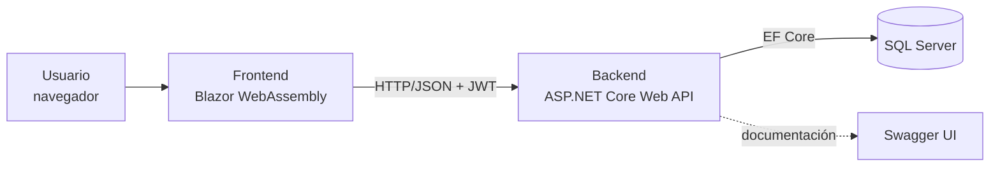
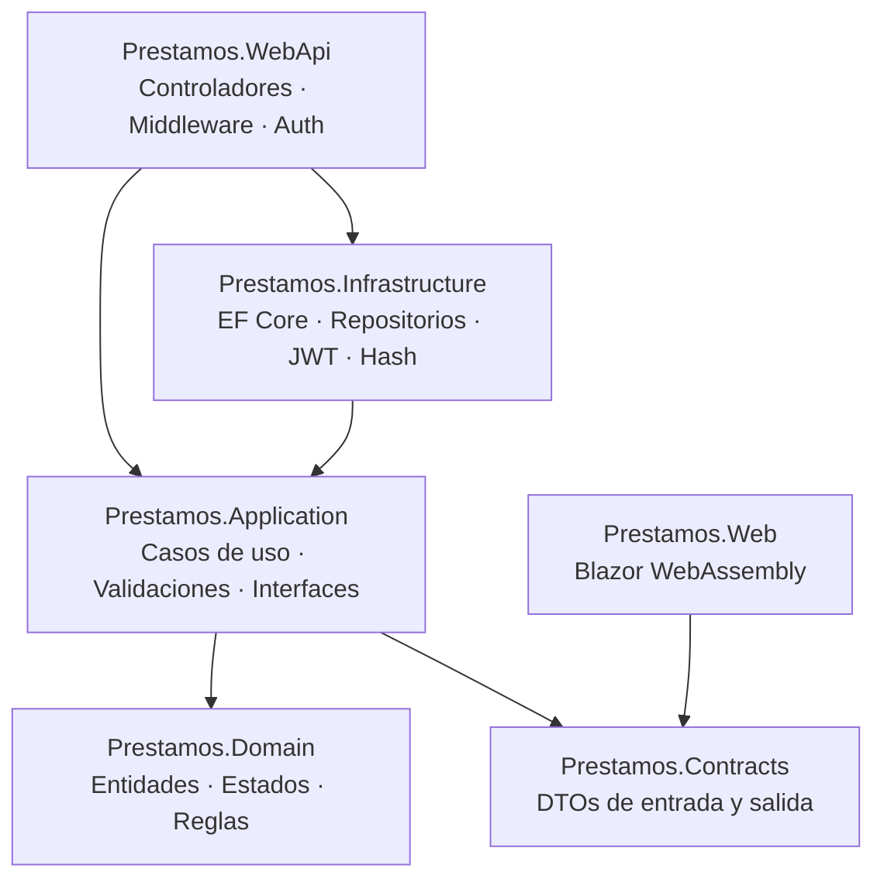
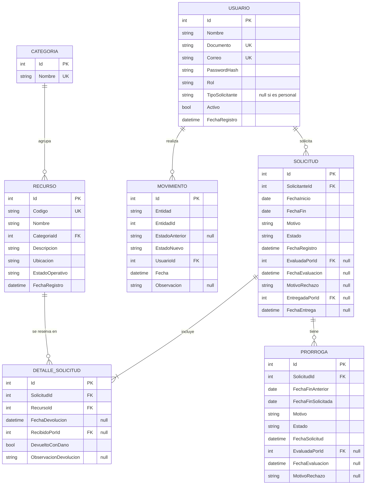
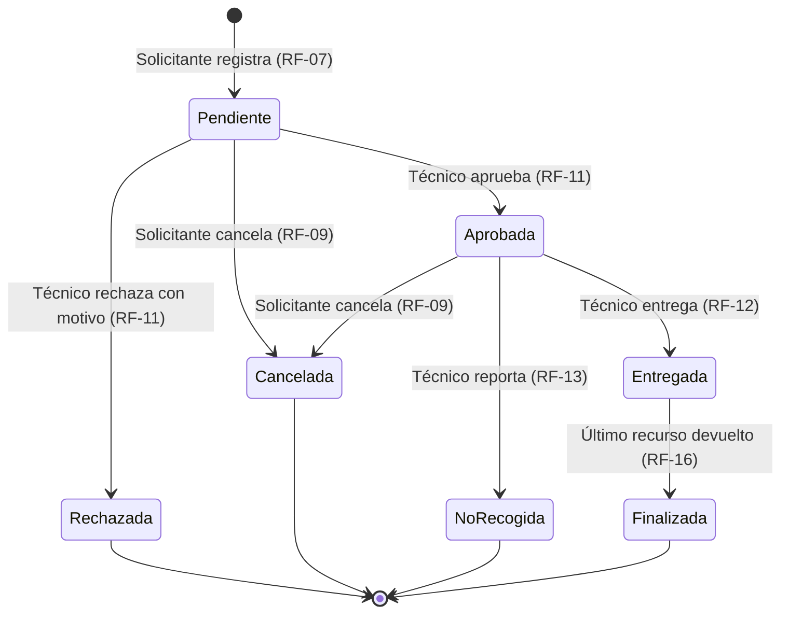
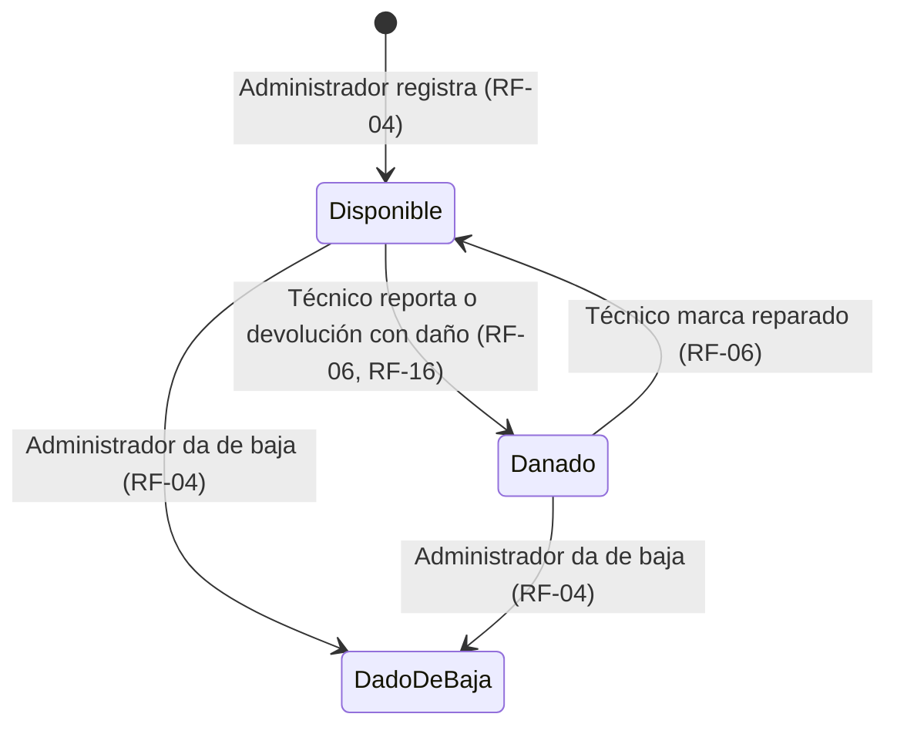
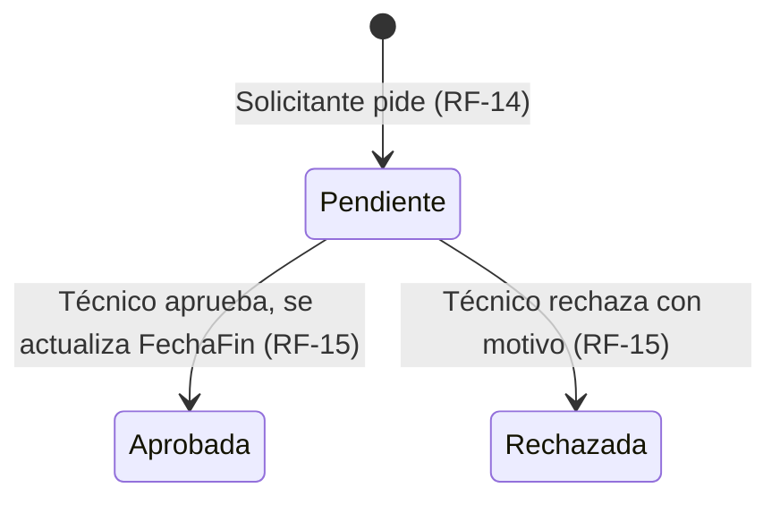
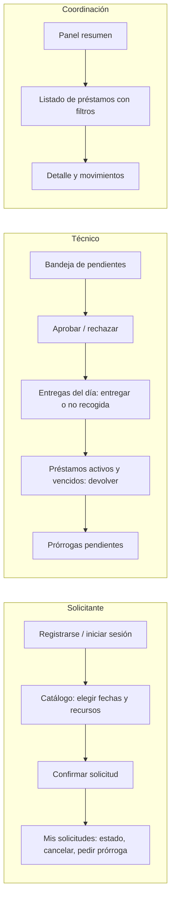

# Diseño — Gestión de préstamos de equipos y recursos

| Campo | Valor |
|---|---|
| Versión | 1.0 |
| Base | [`requisitos.md`](requisitos.md) v1.0 |

---

## 1. Arquitectura

### 1.1 Vista cliente-servidor



| Componente | Responsabilidad |
|---|---|
| **Frontend** (Blazor WebAssembly) | Presenta pantallas por rol, captura datos, valida formatos básicos y consume la API. No contiene reglas de negocio. |
| **API REST** (ASP.NET Core) | Autentica, autoriza por rol, valida entradas, aplica reglas de negocio y devuelve códigos HTTP coherentes. |
| **Base de datos** (SQL Server) | Persiste usuarios, recursos, solicitudes, devoluciones, prórrogas y movimientos con restricciones de integridad. |

### 1.2 Arquitectura Limpia del backend

Las dependencias apuntan hacia el centro: el dominio no conoce la base de datos ni la web.



| Proyecto | Contenido | Depende de |
|---|---|---|
| `Prestamos.Domain` | Entidades, enumeraciones de estado, reglas que cambian estados (Aprobar(), Entregar()…), excepciones de dominio. | Nada |
| `Prestamos.Application` | Servicios de casos de uso, validaciones (FluentValidation), interfaces de repositorios, reloj, hash y token. | Domain, Contracts |
| `Prestamos.Contracts` | DTOs de solicitud y respuesta compartidos entre API y frontend. | Nada |
| `Prestamos.Infrastructure` | `DbContext`, configuraciones de tablas, migraciones, repositorios, JWT y hash de contraseñas. | Application |
| `Prestamos.WebApi` | Controladores, middleware de errores, configuración de autenticación, CORS y Swagger. | Application, Infrastructure |
| `Prestamos.Web` | Páginas, componentes y cliente HTTP. | Contracts |


### 1.3 Estructura del repositorio

```text
/
├── src/
│   ├── Prestamos.Domain/
│   ├── Prestamos.Application/
│   ├── Prestamos.Contracts/
│   ├── Prestamos.Infrastructure/
│   ├── Prestamos.WebApi/
│   └── Prestamos.Web/
├── docs/
├── evidencias/
├── Prestamos.sln
└── README.md
```

---

## 2. Modelo de datos

### 2.1 Diagrama entidad-relación



### 2.2 Dominios de valores

| Campo | Valores |
|---|---|
| `Usuario.Rol` | Solicitante, Tecnico, Coordinacion, Administrador |
| `Usuario.TipoSolicitante` | Estudiante, Docente (solo para el rol Solicitante) |
| `Recurso.EstadoOperativo` | Disponible, Danado, DadoDeBaja |
| `Solicitud.Estado` | Pendiente, Aprobada, Rechazada, Cancelada, NoRecogida, Entregada, Finalizada |
| `Prorroga.Estado` | Pendiente, Aprobada, Rechazada |
| `Movimiento.Entidad` | Solicitud, Recurso, Prorroga |

Los estados se guardan como texto (`nvarchar`) para que las consultas directas a la base de datos sean legibles.

### 2.3 Restricciones e índices

| Restricción | Propósito |
|---|---|
| `UNIQUE (Usuario.Correo)`, `UNIQUE (Usuario.Documento)` | Evitar cuentas duplicadas (HU-11). |
| `UNIQUE (Recurso.Codigo)`, `UNIQUE (Categoria.Nombre)` | Identificación única. |
| `UNIQUE (DetalleSolicitud.SolicitudId, RecursoId)` | Un recurso no se repite dentro de la misma solicitud. |
| `CHECK (Solicitud.FechaFin > Solicitud.FechaInicio)` | Respaldo de RN-04 en la base de datos. |
| Índice `(DetalleSolicitud.RecursoId)` e índice `(Solicitud.Estado, FechaInicio, FechaFin)` | Acelerar el cálculo de disponibilidad. |
| Claves foráneas con `ON DELETE RESTRICT` | No se borran registros con historial; los recursos se dan de baja. |

### 2.4 Datos calculados (no se almacenan)

| Dato | Cálculo |
|---|---|
| **Disponibilidad** de un recurso en `[desde, hasta]` | `EstadoOperativo = Disponible` y no existe un `DetalleSolicitud` de ese recurso en una solicitud `Pendiente`, `Aprobada` o `Entregada` cuyo rango se cruce: `s.FechaInicio <= hasta AND desde <= s.FechaFin`. Un recurso entregado y aún no devuelto (`FechaDevolucion` nula) también bloquea, aunque su fecha de fin ya haya pasado. |
| **Vencida** | `Estado = Entregada` y `FechaFin < hoy` y quedan recursos sin devolver. |

---
### 2.5 Datos semilla (ficticios)

Se cargan automáticamente al aplicar las migraciones, para que la aplicación pueda ejecutarse y probarse en cualquier equipo desde el primer arranque.

| Tipo | Datos |
|---|---|
| Categorías | Portátiles, Cámaras, Instrumentos, Audiovisuales |
| Recursos | 12 recursos (3 por categoría), uno en estado `Danado` |
| Usuarios | 1 administrador, 1 técnico, 1 coordinación, 1 estudiante y 1 docente, con nombres y correos ficticios. Las credenciales se documentan en el README. |
| Solicitudes | Una en cada estado principal, para demostrar las consultas y las pruebas funcionales. |

Ningún dato corresponde a personas reales (sección 5 de la guía).

## 3. Ciclos de vida

### 3.1 Solicitud



### 3.2 Recurso



### 3.3 Prórroga



---

## 4. Especificación de la API

### 4.1 Convenciones

- Prefijo: `/api`. Formato JSON. Fechas de reserva en `yyyy-MM-dd`; fechas y horas en ISO 8601 (hora de Colombia).
- Autenticación: encabezado `Authorization: Bearer <token>`, salvo en registro e inicio de sesión.
- **Las transiciones de estado se exponen como acciones** (`POST /solicitudes/{id}/aprobar`) y no como un `PUT` genérico del estado. Así cada acción tiene su propia validación y su propio permiso, y no se puede saltar del estado `Pendiente` a `Finalizada` editando un campo.
- No hay `DELETE` sobre solicitudes, préstamos ni recursos: el historial se conserva (los recursos se dan de baja).

### 4.2 Códigos de respuesta

| Código | Cuándo |
|---|---|
| `200 OK` | Consulta o acción exitosa. |
| `201 Created` | Registro creado (incluye encabezado `Location`). |
| `400 Bad Request` | Datos con formato inválido o incompletos (validación de entrada). |
| `401 Unauthorized` | Sin token o token inválido. |
| `403 Forbidden` | El rol no tiene permiso, o el recurso pertenece a otro solicitante. |
| `404 Not Found` | La entidad no existe. |
| `409 Conflict` | Se incumple una regla de negocio: recurso no disponible, transición de estado inválida, correo duplicado. |

### 4.3 Formato de error

Todas las respuestas de error usan `ProblemDetails` (RFC 9457) y nunca exponen trazas internas:

```json
{
  "type": "https://httpstatuses.io/409",
  "title": "Recurso no disponible",
  "status": 409,
  "detail": "El recurso PT-003 ya está reservado entre el 2026-11-20 y el 2026-11-25.",
  "errors": null
}
```

En los errores 400, `errors` detalla cada campo:

```json
{
  "title": "Datos inválidos",
  "status": 400,
  "errors": {
    "FechaFin": ["La fecha de fin debe ser posterior a la fecha de inicio."],
    "RecursoIds": ["Debe incluir al menos un recurso."]
  }
}
```

### 4.4 Autenticación y usuarios

| Método | Ruta | Rol | Descripción | Respuestas | RF |
|---|---|---|---|---|---|
| POST | `/api/auth/registro` | Anónimo | Registra un solicitante. | 201, 400, 409 | RF-01 |
| POST | `/api/auth/login` | Anónimo | Devuelve el token JWT y los datos del usuario. | 200, 400, 401 | RF-02 |
| GET | `/api/auth/yo` | Autenticado | Datos del usuario actual. | 200, 401 | RF-02 |
| POST | `/api/usuarios` | Administrador | Registra un técnico o coordinador. | 201, 400, 403, 409 | RF-03 |
| GET | `/api/usuarios` | Administrador | Lista usuarios (filtro por rol). | 200, 403 | RF-03 |
| PATCH | `/api/usuarios/{id}` | Administrador | Corrige el tipo de solicitante o desactiva al usuario. | 200, 400, 403, 404 | RF-03 |

**Ejemplo — `POST /api/auth/registro`**
```json
{
  "nombre": "Ana Pérez",
  "documento": "1000000001",
  "correo": "ana.perez@correo.itm.edu.co",
  "tipoSolicitante": "Estudiante",
  "contrasena": "Clave#2026"
}
```

### 4.5 Catálogo de recursos

| Método | Ruta | Rol | Descripción | Respuestas | RF |
|---|---|---|---|---|---|
| GET | `/api/categorias` | Autenticado | Lista categorías. | 200 | RF-05 |
| POST | `/api/categorias` | Administrador | Crea una categoría. | 201, 400, 403, 409 | RF-04 |
| GET | `/api/recursos` | Autenticado | Lista recursos con disponibilidad. Filtros: `categoriaId`, `desde`, `hasta`, `soloDisponibles`. | 200, 400 | RF-05 |
| GET | `/api/recursos/{id}` | Autenticado | Detalle del recurso y sus próximas reservas. | 200, 404 | RF-05 |
| POST | `/api/recursos` | Administrador | Registra un recurso. | 201, 400, 403, 409 | RF-04 |
| PUT | `/api/recursos/{id}` | Administrador | Edita los datos descriptivos. | 200, 400, 403, 404, 409 | RF-04 |
| PATCH | `/api/recursos/{id}/estado` | Técnico (`Danado` ↔ `Disponible`), Administrador (`DadoDeBaja`) | Cambia el estado operativo. Si quedan reservas futuras afectadas, las devuelve en la respuesta (S-09). | 200, 400, 403, 404, 409 | RF-06 |
| GET | `/api/recursos/{id}/movimientos` | Técnico, Coordinación | Historial de cambios del recurso. | 200, 403, 404 | RF-19 |

**Ejemplo — `GET /api/recursos?desde=2026-11-20&hasta=2026-11-25&categoriaId=1`**
```json
[
  {
    "id": 3,
    "codigo": "PT-003",
    "nombre": "Portátil Lenovo ThinkPad",
    "categoria": "Portátiles",
    "ubicacion": "Bloque P, sala 201",
    "estadoOperativo": "Disponible",
    "disponibleEnRango": false
  }
]
```

### 4.6 Solicitudes

| Método | Ruta | Rol | Descripción | Respuestas | RF |
|---|---|---|---|---|---|
| POST | `/api/solicitudes` | Solicitante | Registra una solicitud. | 201, 400, 403, 404, 409 | RF-07 |
| GET | `/api/solicitudes` | Autenticado | Lista solicitudes. El solicitante solo ve las suyas; técnico y coordinación ven todas. Filtros: `estado`, `vencidas`, `solicitanteId`, `desde`, `hasta`. Orden por fecha de registro (más antiguas primero). | 200 | RF-08, RF-10, RF-17 |
| GET | `/api/solicitudes/{id}` | Dueño, Técnico, Coordinación | Detalle con recursos, devoluciones y prórrogas. | 200, 403, 404 | RF-08 |
| POST | `/api/solicitudes/{id}/cancelar` | Solicitante (dueño) | Cancela si está `Pendiente` o `Aprobada`. | 200, 403, 404, 409 | RF-09 |
| POST | `/api/solicitudes/{id}/aprobar` | Técnico | `Pendiente` → `Aprobada`. Revalida la disponibilidad. | 200, 403, 404, 409 | RF-11 |
| POST | `/api/solicitudes/{id}/rechazar` | Técnico | `Pendiente` → `Rechazada`. Cuerpo: `{ "motivo": "..." }`. | 200, 400, 403, 404, 409 | RF-11 |
| POST | `/api/solicitudes/{id}/entregar` | Técnico | `Aprobada` → `Entregada`, a partir de la fecha de inicio. | 200, 403, 404, 409 | RF-12 |
| POST | `/api/solicitudes/{id}/no-recogida` | Técnico | `Aprobada` → `NoRecogida`. | 200, 403, 404, 409 | RF-13 |
| POST | `/api/solicitudes/{id}/devoluciones` | Técnico | Registra la devolución de un recurso. | 200, 400, 403, 404, 409 | RF-16 |
| GET | `/api/solicitudes/{id}/movimientos` | Dueño, Técnico, Coordinación | Historial de cambios de la solicitud. | 200, 403, 404 | RF-19 |

**Ejemplo — `POST /api/solicitudes`**
```json
{
  "recursoIds": [3, 7],
  "fechaInicio": "2026-11-20",
  "fechaFin": "2026-11-25",
  "motivo": "Grabación del proyecto de la asignatura Medios Audiovisuales"
}
```
Respuesta `201 Created`:
```json
{
  "id": 15,
  "estado": "Pendiente",
  "fechaInicio": "2026-11-20",
  "fechaFin": "2026-11-25",
  "fechaRegistro": "2026-11-12T10:15:00-05:00",
  "recursos": [
    { "id": 3, "codigo": "PT-003", "nombre": "Portátil Lenovo ThinkPad" },
    { "id": 7, "codigo": "CM-001", "nombre": "Cámara Canon EOS" }
  ]
}
```

Validaciones, en orden:

| # | Validación | Error |
|---|---|---|
| 1 | Al menos un recurso, sin repetidos; motivo entre 10 y 300 caracteres; fechas presentes. | 400 |
| 2 | `fechaInicio >= hoy` y `fechaFin > fechaInicio` (RN-04). | 400 |
| 3 | Duración ≤ máximo según el tipo de solicitante: 180 días estudiante, 360 docente (RN-05). | 400 |
| 4 | Todos los recursos existen. | 404 |
| 5 | Todos los recursos están en estado `Disponible` (RN-01). | 409 |
| 6 | Ningún recurso tiene reservas que se crucen (RN-02, RN-07). | 409 |

**Ejemplo — `POST /api/solicitudes/15/devoluciones`**
```json
{
  "recursoId": 7,
  "devueltoConDano": true,
  "observacion": "Lente con rayón visible"
}
```
Efecto: registra la devolución del recurso 7; como viene con daño, el recurso pasa a `Danado` (RN-15). Cuando se devuelve el último recurso, la solicitud pasa a `Finalizada` (RN-14). Devolver un recurso ya devuelto responde 409.

### 4.7 Prórrogas

| Método | Ruta | Rol | Descripción | Respuestas | RF |
|---|---|---|---|---|---|
| POST | `/api/solicitudes/{id}/prorrogas` | Solicitante (dueño) | Pide una nueva fecha de fin. Cuerpo: `{ "nuevaFechaFin": "...", "motivo": "..." }`. | 201, 400, 403, 404, 409 | RF-14 |
| GET | `/api/prorrogas` | Técnico | Lista prórrogas (filtro `estado`). | 200, 403 | RF-15 |
| POST | `/api/prorrogas/{id}/aprobar` | Técnico | Aprueba y actualiza la `FechaFin` de la solicitud. Revalida cruces. | 200, 403, 404, 409 | RF-15 |
| POST | `/api/prorrogas/{id}/rechazar` | Técnico | Rechaza con motivo. | 200, 400, 403, 404, 409 | RF-15 |

Validaciones: la solicitud debe estar `Entregada`; no puede haber otra prórroga `Pendiente`; `nuevaFechaFin > FechaFin` actual; la duración total desde `FechaInicio` no supera el máximo; sin cruces con otras reservas de los mismos recursos (RN-13).

### 4.8 Información consolidada

| Método | Ruta | Rol | Descripción | Respuestas | RF |
|---|---|---|---|---|---|
| GET | `/api/reportes/resumen` | Coordinación, Técnico | Totales por estado, vencidas, recursos por estado operativo y los 5 recursos más utilizados. Filtros: `desde`, `hasta`, `categoriaId`. | 200, 400, 403 | RF-18 |
| GET | `/api/reportes/prestamos` | Coordinación, Técnico | Listado de préstamos con recurso, solicitante, responsable de la entrega y estado. Mismos filtros, más `estado`. | 200, 400, 403 | RF-18 |

**Ejemplo — `GET /api/reportes/resumen?desde=2026-11-01&hasta=2026-11-30`**
```json
{
  "solicitudesPorEstado": {
    "Pendiente": 4, "Aprobada": 2, "Entregada": 6,
    "Finalizada": 11, "Rechazada": 1, "Cancelada": 2, "NoRecogida": 1
  },
  "prestamosVencidos": 2,
  "recursosPorEstado": { "Disponible": 9, "Danado": 2, "DadoDeBaja": 1 },
  "recursosMasUtilizados": [
    { "codigo": "PT-003", "nombre": "Portátil Lenovo ThinkPad", "prestamos": 7 }
  ]
}
```

---

## 5. Aplicación de reglas de negocio y control de acceso

### 5.1 Dónde vive cada regla

| Tipo de regla | Capa | Ejemplo |
|---|---|---|
| Formato y obligatoriedad de datos | Application (FluentValidation) | Motivo obligatorio, fechas válidas. |
| Transiciones de estado | Domain (métodos de la entidad) | `Solicitud.Entregar(hoy)` falla si el estado no es `Aprobada`. |
| Reglas que consultan otros datos | Application (servicio de caso de uso) | Disponibilidad, duración máxima según tipo de solicitante. |
| Integridad | Base de datos | Claves únicas, foráneas y `CHECK` de fechas. |
| Permisos por rol | WebApi (`[Authorize(Roles = ...)]`) | Solo el técnico aprueba. |
| Permisos por propiedad | Application | Un solicitante no puede ver ni cancelar solicitudes ajenas (403). |

El frontend repite algunas validaciones solo para dar una mejor experiencia; **la API nunca confía en ellas** (RNF-03).

### 5.2 Excepciones y su traducción a HTTP

Un middleware global captura las excepciones y las convierte en `ProblemDetails`:

| Excepción | HTTP |
|---|---|
| `ValidationException` | 400 |
| `NotFoundException` | 404 |
| `ForbiddenException` | 403 |
| `BusinessRuleException` (dominio) | 409 |
| Cualquier otra | 500 con mensaje genérico; el detalle solo va al log. |

### 5.3 Concurrencia: dos solicitudes al mismo tiempo (RN-07, RNF-04)

Una restricción única no puede impedir que dos rangos de fechas se crucen, así que la regla se garantiza con una transacción:

1. Abrir una transacción.
2. Bloquear las filas de los recursos pedidos (`SELECT ... FROM Recursos WITH (UPDLOCK, HOLDLOCK) WHERE Id IN (...)`).
3. Verificar que no haya reservas que se crucen.
4. Insertar la solicitud y sus detalles.
5. Confirmar la transacción.

Si dos solicitudes piden el mismo recurso al mismo tiempo, la segunda espera a que termine la primera. Al verificar, ya ve la reserva y responde 409. Así se cumple "al primero que lo pida". El mismo mecanismo se usa al aprobar solicitudes y prórrogas.

### 5.4 Trazabilidad de operaciones (RN-18)

Cada servicio que cambia un estado registra un `Movimiento` dentro de la misma transacción, con el usuario autenticado, la fecha y hora, el estado anterior y el nuevo. Si la operación falla, el movimiento tampoco se guarda.

---

## 6. Recorridos e interfaz

### 6.1 Recorridos principales



### 6.2 Pantallas por rol

| Pantalla | Rol | Funciones | RF |
|---|---|---|---|
| Inicio de sesión / Registro | Todos | Acceso y creación de cuenta. | RF-01, RF-02 |
| Catálogo | Todos | Filtrar por categoría y fechas; ver disponibilidad; agregar recursos a la solicitud. | RF-05 |
| Nueva solicitud | Solicitante | Revisar recursos elegidos, fechas y motivo; enviar. | RF-07 |
| Mis solicitudes | Solicitante | Estado, detalle, cancelar, pedir prórroga, historial. | RF-08, RF-09, RF-14, RF-17 |
| Bandeja de solicitudes | Técnico | Pendientes en orden de llegada; aprobar o rechazar. | RF-10, RF-11 |
| Entregas | Técnico | Aprobadas desde la fecha de inicio; entregar o marcar no recogida. | RF-12, RF-13 |
| Préstamos activos | Técnico | Entregados y vencidos resaltados; registrar devoluciones. | RF-16 |
| Prórrogas | Técnico | Aprobar o rechazar. | RF-15 |
| Estado de recursos | Técnico | Marcar dañado o reparado; ver reservas afectadas. | RF-06 |
| Panel de coordinación | Coordinación, Técnico | Indicadores, listado de préstamos con filtros, movimientos. | RF-18, RF-19 |
| Administración | Administrador | Usuarios del personal, categorías y recursos. | RF-03, RF-04 |

El menú lateral muestra solo las pantallas del rol del usuario. Aun así, la API valida cada permiso.

### 6.3 Prototipos

**Catálogo (solicitante)**
```text
┌───────────────────────────────────────────────────────────────────┐
│ Préstamos ITM            Catálogo | Mis solicitudes    Ana Pérez ▾│
├───────────────────────────────────────────────────────────────────┤
│ Desde [2026-11-20]  Hasta [2026-11-25]  Categoría [Todas ▾] [Buscar]│
│ ☐ Solo disponibles                                                │
├──────────┬──────────────────────────┬─────────────┬───────────────┤
│ Código   │ Recurso                  │ Estado      │               │
├──────────┼──────────────────────────┼─────────────┼───────────────┤
│ PT-001   │ Portátil HP ProBook      │ ● Disponible│ [+ Agregar]   │
│ PT-003   │ Portátil Lenovo ThinkPad │ ● Reservado │   —           │
│ CM-001   │ Cámara Canon EOS         │ ● Disponible│ [✓ Agregado]  │
│ CM-002   │ Cámara Sony Alpha        │ ● Dañado    │   —           │
├──────────┴──────────────────────────┴─────────────┴───────────────┤
│                         Recursos seleccionados: 1  [Continuar →]  │
└───────────────────────────────────────────────────────────────────┘
```

**Bandeja de solicitudes (técnico)**
```text
┌───────────────────────────────────────────────────────────────────┐
│ Bandeja | Entregas | Préstamos activos (2 vencidos) | Prórrogas   │
├───────────────────────────────────────────────────────────────────┤
│ Pendientes (orden de llegada)                                     │
├─────┬───────────────┬────────────────────┬─────────────┬──────────┤
│ #   │ Solicitante   │ Recursos           │ Fechas      │ Acción   │
├─────┼───────────────┼────────────────────┼─────────────┼──────────┤
│ 14  │ Juan Gómez    │ PT-001             │ 18/11–22/11 │[Aprobar] │
│     │ (Docente)     │                    │             │[Rechazar]│
│ 15  │ Ana Pérez     │ PT-001, CM-001     │ 20/11–25/11 │[Aprobar] │
│     │ (Estudiante)  │                    │             │[Rechazar]│
└─────┴───────────────┴────────────────────┴─────────────┴──────────┘
  Rechazar → ventana: "Motivo del rechazo (obligatorio)" [Confirmar]
```

**Panel de coordinación**
```text
┌───────────────────────────────────────────────────────────────────┐
│ Desde [2026-11-01] Hasta [2026-11-30] Categoría [Todas ▾] [Aplicar]│
├──────────────┬──────────────┬──────────────┬──────────────────────┤
│ Activos      │ Vencidos     │ Finalizados  │ Recursos dañados     │
│     6        │     2        │    11        │      2               │
├──────────────┴──────────────┴──────────────┴──────────────────────┤
│ Más utilizados: PT-003 (7) · CM-001 (5) · PT-001 (4)              │
├───────────────────────────────────────────────────────────────────┤
│ Préstamos                                       Estado [Todos ▾]  │
│ #12  PT-003  Ana Pérez   Entregó: C. Ruiz   15/11–18/11  VENCIDO  │
│ #13  CM-001  Juan Gómez  Entregó: C. Ruiz   16/11–30/11  Activo   │
│ #09  PT-001  Ana Pérez   Entregó: C. Ruiz   02/11–05/11  Finaliz. │
└───────────────────────────────────────────────────────────────────┘
```

---

## 7. Decisiones técnicas

| Decisión | Alternativas consideradas | Justificación | Requisitos |
|---|---|---|---|
| **ASP.NET Core Web API sobre .NET 10 (LTS)** | Node/Express, Django | Versión con soporte extendido; tipado fuerte; autenticación, validación y documentación integradas; dominio del equipo en C#. | RT-01 |
| **SQL Server + Entity Framework Core** | PostgreSQL, SQLite | Motor relacional con transacciones y bloqueos para la regla de concurrencia; LocalDB o Express gratuitos para ejecutar localmente; migraciones reproducibles. | RNF-04, RNF-07 |
| **Arquitectura Limpia (4 capas + Contracts)** | MVC en un solo proyecto | Aísla las reglas de negocio, que son el núcleo del proyecto; facilita explicar y probar cada regla. Sin CQRS ni MediatR, para no agregar complejidad que el alcance no requiere. | RNF-08 |
| **Blazor WebAssembly** | React, Angular, MVC con vistas | Mismo lenguaje en frontend y backend; DTOs compartidos; separación cliente-servidor real (el navegador consume la API por HTTP). | RT-01, RT-02 |
| **JWT con roles** | Cookies de sesión | API sin estado, consumible por el frontend y por herramientas HTTP en las pruebas; roles en el token para `[Authorize]`. | RNF-01, RNF-02 |
| **Hash de contraseñas con `PasswordHasher` de ASP.NET Core Identity** | BCrypt | Incluido en el framework; algoritmo con sal e iteraciones. | RNF-01 |
| **FluentValidation** | Data Annotations | Reglas de validación legibles y separadas de los DTOs. | RNF-03 |
| **ProblemDetails + middleware global** | Respuestas de error propias | Formato estándar (RFC 9457) y un solo punto de manejo de errores. | RNF-05 |
| **Swagger UI** | Postman | Documentación interactiva generada desde el código; permite ejecutar las pruebas funcionales. | Actividad 6 |
| **Estados como acciones `POST`** | `PUT`/`PATCH` del campo estado | Cada transición tiene su permiso y su validación; evita saltos de estado inválidos. | RN-08 a RN-14 |
| **Duraciones máximas en `appsettings.json`** | Valores fijos en el código | Si cambia la política, se ajusta sin recompilar. | RN-05 |
| **Disponibilidad calculada, no almacenada** | Campo `Prestado` en el recurso | Con reservas por fechas, un recurso puede estar libre hoy y ocupado la próxima semana; un campo fijo se desincronizaría. | RN-02 |

---

## 8. Correspondencia con condiciones de aceptación

| CA | Requisitos | Endpoints | Pantallas |
|---|---|---|---|
| CA-01 | RF-04, RF-05, RF-06 | `GET /api/recursos`, `PATCH /api/recursos/{id}/estado` | Catálogo, Estado de recursos |
| CA-02 | RF-07, RF-08, RF-09 | `POST /api/solicitudes`, `GET /api/solicitudes`, `POST .../cancelar` | Nueva solicitud, Mis solicitudes |
| CA-03 | RF-10, RF-11, RF-13 | `POST .../aprobar`, `.../rechazar`, `.../no-recogida` | Bandeja, Entregas |
| CA-04 | RF-12, RN-02, RN-07 | `POST .../entregar` + control de concurrencia | Entregas |
| CA-05 | RF-14, RF-15, RF-16, RF-17, RF-19 | `POST .../devoluciones`, `.../prorrogas`, `GET .../movimientos` | Préstamos activos, Prórrogas, Mis solicitudes |
| CA-06 | RF-18, RF-19 | `GET /api/reportes/resumen`, `GET /api/reportes/prestamos` | Panel de coordinación |
